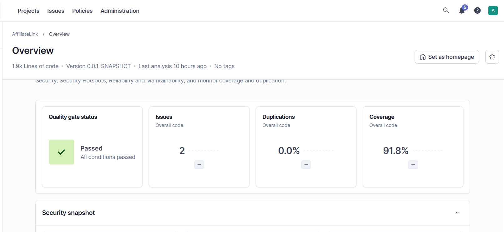

<p align="center">
  
  
  
  
  
  
  
</p>
<p align="center">
  
  
  
  
</p>

<h1 align="center">AffiliateLink — Plateforme d'affiliation</h1>

<p align="center">
  <a href="Readme.en.md">🇬🇧 English version</a>
</p>

Plateforme d'affiliation **AffiliateLink**, organisée en modules **Spring Modulith**.

- Le module **profile** gère l'identité des acteurs (publishers et advertisers) et leur cycle de validation par un administrateur.
- Le module **offer** permet à un advertiser actif de publier des offres, puis de lancer des campagnes qui fixent la période, le budget et le modèle de rémunération des publishers (CPC, CPL ou CPA).

Les deux modules sont indépendants : ils communiquent uniquement par leurs **API publiques** ou par des **événements**, jamais en accédant aux classes ou aux tables de l'autre.

Le projet est protégé par **239 tests automatisés** (unitaires, repository, contrôleur, module et intégration complète), une mesure de couverture **JaCoCo** et une analyse **SonarQube** : voir [Tests](#tests) et [Qualité du code](#qualité-du-code).

## Sommaire

- [Fonctionnalités](#fonctionnalités)
- [Règles de gestion](#règles-de-gestion)
- [Stack technique](#stack-technique)
- [Architecture](#architecture)
- [Communication entre modules](#communication-entre-modules)
- [Modèle de données](#modèle-de-données)
- [Démarrage rapide](#démarrage-rapide)
- [Configuration](#configuration)
- [API](#api)
- [Transactions et logging](#transactions-et-logging)
- [Dépannage](#dépannage)
- [Tests](#tests)
- [Qualité du code](#qualité-du-code)
- [Décisions de conception](#décisions-de-conception)
- [Limites connues](#limites-connues)

## Fonctionnalités

**Module profile**

- Création de compte **publisher** (email, prénom, nom, niche, bio, pays)
- Création de compte **advertiser** (email, raison sociale, secteur, site web)
- Consultation d'un profil par identifiant, et de la liste des publishers / advertisers
- Validation, suspension et réactivation d'un compte par un administrateur
- Publication de l'événement `ProfileSuspended` à la suspension d'un compte

**Module offer**

- Création et modification d'une **offre** (titre, description, URL de destination, niche, mots-clés)
- **Recherche** d'offres par critères optionnels combinables (niche, advertiser, tag, mot-clé dans le titre), paginée et triée
- Consultation d'une offre avec ses campagnes
- Création d'une **campagne** (nom, dates, budget, modèle de rémunération et montant)
- Activation, mise en pause, réactivation et clôture d'une campagne
- Liste des campagnes, filtrable par statut
- Mise en pause automatique des campagnes d'un advertiser suspendu, et notification des publishers

## Règles de gestion

### Profils

| Règle | Description |
|---|---|
| Email unique | Un même email ne peut pas servir à un publisher **et** à un advertiser |
| Niches disponibles | `BEAUTY`, `TECH`, `GAMING`, `TRAVEL`, `LIFESTYLE`, `FOOD`, `SPORT` |
| Statut par défaut | Tout nouveau compte est créé avec le statut `PENDING` |
| Suppression | Un compte n'est jamais supprimé, uniquement suspendu |

```
PENDING ──activate()──▶ ACTIVE ──suspend()──▶ SUSPENDED
                           ▲                      │
                           └──────reactivate()────┘
```

Toute autre transition lève une `InvalidStatusTransitionException` (HTTP 409). Cette logique est portée par l'entité `Profile`, pas par les contrôleurs.

### Offres

| Règle | Description |
|---|---|
| Advertiser actif | Seul un advertiser **existant et actif** peut créer une offre (404 s'il n'existe pas, 409 s'il n'est pas actif) |
| Modification | Elle revérifie que l'advertiser est toujours actif ; l'`advertiserId` d'une offre ne change jamais |
| Tags | Enregistrés en **minuscules**, **jamais dupliqués**, **partagés** entre les offres (un tag existant est réutilisé) |
| Niche | Valeur de l'enum `Niche` (même liste que pour les profils) |

### Campagnes

| Règle | Description |
|---|---|
| Statut initial | Une campagne est créée en `DRAFT` |
| Dates et budget | `endDate` strictement postérieure à `startDate` ; `budget` strictement positif |
| Date de fin dépassée | La campagne ne peut pas être activée |
| Une seule campagne active par offre | Activer une campagne met automatiquement en pause celle qui était active sur la même offre |
| Suspension d'un advertiser | Toutes ses campagnes actives passent en `PAUSED` |

**Modèles de rémunération**

| Modèle | Signification | Montant attendu |
|---|---|---|
| `CPC` | Paiement par clic | Montant fixe en euros, > 0 |
| `CPL` | Paiement par inscription (lead) | Montant fixe en euros, > 0 |
| `CPA_FIXED` | Paiement par vente, montant fixe | Montant fixe en euros, > 0 |
| `CPA_PERCENT` | Paiement par vente, pourcentage | Pourcentage > 0 et ≤ 100 |

**Transitions de statut** (portées par l'entité `Campaign` : `activate()`, `pause()`, `end()`)

```
DRAFT ──▶ ACTIVE ◀──▶ PAUSED
             │           │
             └──▶ ENDED ◀┘        (ENDED : aucune sortie)
```

| Statut actuel | Transitions autorisées |
|---|---|
| `DRAFT` | `ACTIVE` |
| `ACTIVE` | `PAUSED`, `ENDED` |
| `PAUSED` | `ACTIVE`, `ENDED` |
| `ENDED` | aucune |

Toute autre transition lève une `InvalidStatusTransitionException` (HTTP 409).

## Stack technique

| Composant | Technologie |
|---|---|
| Langage | Java 17 |
| Framework | Spring Boot 4.1.1 (Spring Framework 7) |
| Architecture modulaire | Spring Modulith 2.1.1 (`core`, `jpa`, `test`) |
| Persistance | Spring Data JPA / Hibernate ORM 7 |
| Base de données | PostgreSQL 18 |
| Migrations | Flyway (`spring-boot-starter-flyway` + `flyway-database-postgresql`) |
| Mapping entité ↔ DTO | MapStruct 1.6.3 |
| Validation | Bean Validation (Jakarta) |
| Logging | SLF4J / Logback (console + fichier avec rotation) |
| Environnement local | Docker Compose (démarré automatiquement par Spring Boot) |
| Build | Maven (wrapper inclus) |
| Tests | JUnit Jupiter, Mockito, AssertJ, Spring Boot Test, Spring Modulith Test |
| Tests d'intégration | Testcontainers 2.0.5 (PostgreSQL 18 dans Docker), Awaitility |
| Couverture | JaCoCo 0.8.13 (seuil : 60 % des lignes) |
| Qualité | SonarQube Community Build (Docker, en local) |

## Architecture

Organisation **par domaine** (package-by-feature). Chaque sous-package direct du package principal est un **module** Spring Modulith.

```
com.affiliateLink
├── common                               (module ouvert, partagé)
│   ├── GlobalExceptionHandler           (@RestControllerAdvice → ProblemDetail)
│   ├── Niche                            (enum partagé profile / offer)
│   ├── ResourceNotFoundException        → 404
│   ├── ConflictException                → 409
│   ├── DuplicateEmailException          → 409
│   └── InvalidStatusTransitionException → 409
│
├── profile
│   ├── ProfileApi                       ◀ API publique
│   ├── AdvertiserInfo                   ◀ record public
│   ├── ProfileSuspended                 ◀ événement public
│   └── internal                         (interdit aux autres modules)
│       ├── controller   PublisherController, AdvertiserController, AdminProfileController
│       ├── dto          PublisherCreateRequest/Response, AdvertiserCreateRequest/Response, StatusUpdateRequest
│       ├── entity       Profile (abstraite), Publisher, Advertiser, ProfileStatus
│       ├── repository   ProfileRepository, PublisherRepository, AdvertiserRepository
│       └── service      PublisherService, AdvertiserService, AdminProfileService, ProfileApiImpl
│
└── offer
    ├── OfferApi                         ◀ API publique
    ├── CampaignInfo                     ◀ record public
    └── internal                         (interdit aux autres modules)
        ├── controller   OfferController, CampaignController
        ├── dto          OfferCreateRequest, OfferUpdateRequest, OfferResponse, OfferSummaryResponse,
        │                CampaignCreateRequest, CampaignResponse, CampaignStatusUpdateRequest, PageResponse
        ├── entity       Offer, Campaign, Tag, PayoutModel, CampaignStatus
        ├── mapper       OfferMapper, CampaignMapper (MapStruct)
        ├── repository   OfferRepository, OfferSpecifications, CampaignRepository, TagRepository
        ├── service      OfferService / OfferServiceImpl, CampaignService / CampaignServiceImpl,
        │                OfferApiImpl, NotificationSender / LogNotificationSender
        └── listener     ProfileSuspendedListener, PublisherNotificationListener
```

**Règle d'or** : seules les classes situées à la **racine** d'un module sont visibles des autres modules. Tout ce qui est dans `internal` est privé. Cette règle est vérifiée automatiquement par `ModularityTest` (`ApplicationModules.of(...).verify()`) : le build échoue si un module accède à l'`internal` d'un autre, ou en cas de dépendance circulaire.

Chaque couche a une responsabilité précise :

- **Controller** : expose l'API REST, délègue tout au service
- **Service** : orchestre la logique métier, expose une **interface** et une implémentation (`...Impl`)
- **Entity** : porte les règles métier invariantes (statut par défaut, transitions, bornes des montants)
- **Mapper** : conversions entité ↔ DTO générées à la compilation par MapStruct
- **DTO** : seuls objets exposés par l'API (des `record`) — les entités JPA ne sont jamais sérialisées directement

## Communication entre modules

Deux mécanismes, et uniquement ceux-là :

| Mécanisme | Quand | Exemple |
|---|---|---|
| **Appel direct** via l'API publique | On a besoin d'une réponse immédiate | `offer` appelle `ProfileApi.isActive(id)` |
| **Événement** de domaine | On informe sans connaître les destinataires | `profile` publie `ProfileSuspended` |

```
┌──────────── module profile ────────────┐        ┌───────────── module offer ─────────────┐
│                                        │        │                                        │
│  ProfileApi ◀──── appel synchrone ─────┼────────┼── OfferService / CampaignService       │
│   • getAdvertiser(id)                  │        │    (l'advertiser existe-t-il ? actif ?)│
│   • isActive(id)                       │        │                                        │
│   • getActivePublisherEmails()         │        │                                        │
│                                        │        │                                        │
│  AdminProfileService                   │        │  ProfileSuspendedListener              │
│   suspend ─▶ ProfileSuspended ─────────┼─ event ┼─▶ met en PAUSED les campagnes ACTIVE   │
│                    │                   │        │                                        │
│                    └───────────────────┼─ event ┼─▶ PublisherNotificationListener        │
│                                        │        │    notifie les publishers actifs       │
└────────────────────────────────────────┘        │                                        │
                                                  │  OfferApi ◀── futur module affiliate   │
                                                  │   • getCampaign(id)                    │
                                                  └────────────────────────────────────────┘
```

### API publiques

| API | Méthode | Retour |
|---|---|---|
| `ProfileApi` | `getAdvertiser(Long id)` | `Optional<AdvertiserInfo>` — jamais l'entité `Advertiser` |
| `ProfileApi` | `isActive(Long id)` | `boolean` — `true` seulement si l'advertiser existe et est `ACTIVE` |
| `ProfileApi` | `getActivePublisherEmails()` | `List<String>` |
| `OfferApi` | `getCampaign(Long campaignId)` | `Optional<CampaignInfo>` — prévue pour le futur module `affiliate` |

`CampaignInfo` expose `payoutModel` et `status` sous forme de `String` pour ne pas dépendre des enums internes du module.

### Événements

`ProfileSuspended(Long profileId)` est publié par `AdminProfileService` quand un compte passe à `SUSPENDED` (et uniquement dans ce cas : l'activation n'en publie aucun).

Deux listeners, dans le module `offer`, annotés `@ApplicationModuleListener` :

1. **`ProfileSuspendedListener`** : passe en `PAUSED` toutes les campagnes `ACTIVE` des offres de l'advertiser suspendu.
2. **`PublisherNotificationListener`** : demande aux publishers actifs d'arrêter de partager les liens, via l'interface `NotificationSender` (implémentée aujourd'hui par `LogNotificationSender`).

`@ApplicationModuleListener` garantit que le listener s'exécute **après le commit** de la transaction du module `profile`, dans **sa propre transaction**, de façon **asynchrone** (`@EnableAsync`). Les deux listeners sont **séparés volontairement** : l'échec d'une notification ne doit jamais empêcher la mise en pause des campagnes.

### Registre d'événements

Grâce à `spring-modulith-starter-jpa`, chaque événement est enregistré dans la table `event_publication` (migration `V4`), dans la même transaction que la suspension. Un événement dont un listener a échoué reste non complété (`completion_date` nul) : il n'est donc pas perdu.

## Modèle de données

Héritage JPA en stratégie **JOINED** pour les profils ; un schéma relationnel classique pour les offres. Chaque module possède **ses propres tables**, préfixées par son nom.

```
profile_profiles (id, email UNIQUE, status, created_at)
        │
        ├── profile_publishers (id FK, first_name, last_name, niche, bio, country)
        └── profile_advertisers (id FK, company_name, sector, website)

offer_offers (id, advertiser_id, title, description, landing_url, niche, created_at)
        │ 1                                  
        │                offer_offer_tags (offer_id, tag_id)        PK composite
        │ N ◀──────────────────────────────────────────────────▶ offer_tags (id, name UNIQUE)
        ▼
offer_campaigns (id, offer_id FK, name, start_date, end_date, budget,
                 payout_model, payout_value, status)
```

| Migration | Contenu |
|---|---|
| `V1` – `V3` | `profile_profiles`, `profile_publishers`, `profile_advertisers` |
| `V4` | `event_publication` (registre d'événements Modulith) |
| `V5` | `offer_offers` |
| `V6` | `offer_campaigns` |
| `V7` | `offer_tags` |
| `V8` | `offer_offer_tags` (table de jointure) |
| `V9` | Suppression de la contrainte d'unicité sur le prénom des publishers |

Points clés :

- **`advertiser_id` est un simple `BIGINT`, sans clé étrangère** vers `profile_advertisers` : le module `offer` ne touche jamais aux tables de `profile`. L'existence et l'état de l'advertiser sont vérifiés via `ProfileApi`.
- Montants en `NUMERIC(12,2)` (`BigDecimal`), dates en `DATE` (`LocalDate`), enums stockés en texte.
- Contraintes `CHECK` en base (budget > 0, `end_date > start_date`, pourcentage ≤ 100, valeurs d'enums) en complément de la validation applicative.
- **Index unique partiel** `uq_offer_one_active_campaign ON offer_campaigns (offer_id) WHERE status = 'ACTIVE'` : la base garantit qu'une offre n'a jamais deux campagnes actives, même en cas d'accès concurrents.
- Relations JPA : `Offer` 1—N `Campaign` (bidirectionnelle, `Campaign` est le côté propriétaire) ; `Offer` N—N `Tag` (`Offer` est le côté propriétaire).

Les tables sont créées et versionnées via Flyway (`src/main/resources/db/migration`), avec Hibernate en mode `ddl-auto: validate` — aucune modification de schéma n'est faite au runtime. Une migration déjà appliquée ne doit jamais être modifiée : toute correction passe par une nouvelle version.

## Démarrage rapide

### Prérequis

- JDK 17+
- Docker Desktop (lancé)

### Lancer l'application

```bash
./mvnw spring-boot:run
```

Spring Boot détecte automatiquement `docker-compose.yml` et démarre PostgreSQL avant de lancer l'application (le conteneur reste démarré après l'arrêt de l'application : `lifecycle-management: start-only`). Flyway applique les migrations au démarrage (`V1` à `V9`).

L'API est accessible sur `http://localhost:8080`.

### Vérifier la base de données

```bash
docker exec -it affiliatelink-postgres-1 psql -U postgres -d affiliatelink
```

```sql
\dt
SELECT event_type, completion_date FROM event_publication;
```

## Configuration

### `docker-compose.yml`

```yaml
services:
  postgres:
    image: postgres:18
    environment:
      POSTGRES_DB: affiliatelink
      POSTGRES_USER: postgres
      POSTGRES_PASSWORD: admin
    ports:
      - "5433:5432"
    volumes:
      - affiliatelink-data:/var/lib/postgresql

volumes:
  affiliatelink-data:
```

### `application.yml`

```yaml
spring:
  docker:
    compose:
      enabled: true
      lifecycle-management: start-only    # PostgreSQL reste démarré après l'arrêt de l'application
  jpa:
    hibernate:
      ddl-auto: validate
    properties:
      hibernate:
        default_batch_fetch_size: 20      # évite le problème N+1 sur les tags
  flyway:
    enabled: true
    locations: classpath:db/migration
  data:
    web:
      pageable:
        default-page-size: 20
        max-page-size: 100                # empêche ?size=100000
  modulith:
    events:
      jdbc:
        schema-initialization:
          enabled: false                  # la table event_publication est créée par Flyway (V4)
```

Pendant les tests, la base de `application.yml` n'est **jamais** utilisée : Testcontainers fournit un PostgreSQL 18 jetable, et Spring Boot ignore `docker-compose.yml` dans les tests.

### `docker-compose.sonar.yml`

SonarQube Community, pour l'analyse de qualité en local (voir [Analyse SonarQube](#analyse-sonarqube-locale)). Il est volontairement **séparé** de `docker-compose.yml` : sinon Spring Boot démarrerait SonarQube (environ 2 Go de RAM) à chaque lancement de l'application.

```yaml
name: affiliatelink-sonar

services:
  sonarqube:
    image: sonarqube:community
    container_name: affiliatelink-sonarqube
    ports:
      - "9000:9000"
    environment:
      SONAR_ES_BOOTSTRAP_CHECKS_DISABLE: "true"
    volumes:
      - sonarqube_data:/opt/sonarqube/data
      - sonarqube_extensions:/opt/sonarqube/extensions
      - sonarqube_logs:/opt/sonarqube/logs

volumes:
  sonarqube_data:
  sonarqube_extensions:
  sonarqube_logs:
```

### Logging — `logback-spring.xml`

- Sortie **console** et **fichier** `logs/affiliatelink.log`
- Rotation par taille et par jour : 10 Mo par fichier, archives compressées (`.gz`) dans `logs/archived/`, 30 jours d'historique, 1 Go maximum
- Niveau `DEBUG` pour `com.affiliateLink` hors profil `prod`, `INFO` ailleurs
- Le dossier `logs/` est ignoré par Git

## API

### Module offer

| Méthode | Endpoint | Description | Réponses |
|---|---|---|---|
| `POST` | `/api/offres` | Créer une offre | `201` / `400` / `404` / `409` |
| `GET` | `/api/offres` | Rechercher des offres (paginé, trié) | `200` / `400` |
| `GET` | `/api/offres/{id}` | Consulter une offre avec ses campagnes | `200` / `404` |
| `PUT` | `/api/offres/{id}` | Modifier une offre | `200` / `400` / `404` / `409` |
| `POST` | `/api/offres/{id}/campaigns` | Créer une campagne (en `DRAFT`) | `201` / `400` / `404` / `409` |
| `GET` | `/api/campaigns?status=` | Lister les campagnes (filtre optionnel) | `200` / `400` |
| `PATCH` | `/api/campaigns/{id}/status` | Changer le statut d'une campagne | `204` / `400` / `404` / `409` |

### Module profile

| Méthode | Endpoint | Réponses |
|---|---|---|
| `POST` | `/api/publishers` | `201` / `400` / `409` |
| `GET` | `/api/publishers` | `200` |
| `GET` | `/api/publishers/{id}` | `200` / `404` |
| `POST` | `/api/advertisers` | `201` / `400` / `409` |
| `GET` | `/api/advertisers` | `200` |
| `GET` | `/api/advertisers/{id}` | `200` / `404` |
| `PATCH` | `/api/admin/profiles/{id}/status` | `204` / `400` / `404` / `409` |

### Exemple — créer une offre

```http
POST /api/offres
Content-Type: application/json

{
  "advertiserId": 1,
  "title": "Pro VPN",
  "description": "VPN rapide et sécurisé",
  "landingUrl": "https://vpn.example.com",
  "niche": "TECH",
  "tags": ["VPN", "Security", " vpn "]
}
```

Réponse `201 Created` — les tags sont normalisés et dédupliqués :

```json
{
  "id": 1,
  "advertiserId": 1,
  "title": "Pro VPN",
  "description": "VPN rapide et sécurisé",
  "landingUrl": "https://vpn.example.com",
  "niche": "TECH",
  "createdAt": "2026-11-10T10:15:00Z",
  "tags": ["vpn", "security"],
  "campaigns": []
}
```

### Exemple — créer puis activer une campagne

```http
POST /api/offres/1/campaigns
Content-Type: application/json

{
  "name": "Winter Sale",
  "startDate": "2026-11-10",
  "endDate": "2027-01-31",
  "budget": 1000.00,
  "payoutModel": "CPC",
  "payoutValue": 0.50
}
```

La campagne est créée avec le statut `DRAFT`. Pour l'activer :

```http
PATCH /api/campaigns/1/status
Content-Type: application/json

{ "status": "ACTIVE" }
```

Si une autre campagne était déjà `ACTIVE` sur la même offre, elle passe automatiquement en `PAUSED`.

### Recherche d'offres

`GET /api/offres?niche=&advertiserId=&tag=&keyword=&page=&size=&sort=`

| Paramètre | Description |
|---|---|
| `niche` | Valeur de l'enum `Niche` |
| `advertiserId` | Offres d'un advertiser |
| `tag` | Offres portant ce tag (insensible à la casse) |
| `keyword` | Mot-clé contenu dans le titre (insensible à la casse) |
| `page` | Numéro de page, **à partir de 0** |
| `size` | Taille de page |
| `sort` | `champ,asc` ou `champ,desc` |

- Tous les critères sont **optionnels** et **combinables** ; sans critère, toutes les offres sont renvoyées.
- Champs triables : `id`, `title`, `niche`, `createdAt`, `advertiserId`. Tout autre champ → `400`.
- Sans `sort`, le tri par défaut est `createdAt` décroissant (les plus récentes d'abord), pour un ordre stable entre les pages.

```json
{
  "content": [ { "id": 3, "title": "Pro VPN", "niche": "TECH", "tags": ["vpn"] } ],
  "page": 0,
  "size": 10,
  "totalElements": 95,
  "totalPages": 10
}
```

La recherche est construite dynamiquement avec des **`Specification`** JPA (`OfferSpecifications`) : chaque critère fourni ajoute une condition, les critères absents sont ignorés.

### Codes d'erreur

Toutes les erreurs sont centralisées dans un unique `@RestControllerAdvice` (`GlobalExceptionHandler`, module `common`).

| Code | Cas |
|---|---|
| `400` | Validation Bean Validation, JSON illisible ou valeur d'enum inconnue, paramètre invalide (`?niche=XYZ`), champ de tri non autorisé |
| `404` | Offre, campagne, profil ou advertiser inexistant |
| `409` | Advertiser non actif, email déjà utilisé, transition de statut interdite, conflit d'intégrité |
| `500` | Erreur inattendue : détail dans les logs uniquement, message générique côté client |

Format des erreurs : **`ProblemDetail`** (RFC 9457), avec `Content-Type: application/problem+json`.

```json
{
  "type": "about:blank",
  "title": "Conflict",
  "status": 409,
  "detail": "Advertiser is not active",
  "instance": "/api/offres"
}
```

Pour une erreur de validation, `detail` liste les champs fautifs (`email: must be a well-formed email address; ...`). Pour une erreur `500`, le client reçoit seulement `Internal server error`.

## Transactions et logging

### Transactions

- `@Transactional(readOnly = true)` sur **chaque service** (lectures optimisées), `@Transactional` sur chaque méthode qui écrit.
- **Activation d'une campagne atomique** : mise en pause de l'ancienne campagne active (`saveAndFlush`, pour que l'écriture précède l'activation et respecte l'index unique), puis activation de la nouvelle. Si une étape échoue (ex. date de fin dépassée), tout est annulé : l'ancienne campagne reste active.
- La **suspension d'un compte** et l'**enregistrement de l'événement** dans `event_publication` se font dans la même transaction.
- Les listeners de `ProfileSuspended` s'exécutent **après le commit**, chacun dans **sa propre transaction**.
- Les exceptions métier héritent de `RuntimeException`, condition pour que Spring annule la transaction.

### Logging

Un logger par classe : `private static final Logger log = LoggerFactory.getLogger(MaClasse.class);`

| Niveau | Usage |
|---|---|
| `INFO` | Actions métier réussies (création, changement de statut) |
| `WARN` | Situation anormale attendue (transition refusée, advertiser inactif) |
| `ERROR` | Erreur inattendue (avec la stack trace) |
| `DEBUG` | Détail (critères de recherche) |

**Aucune donnée sensible** dans les logs : pas d'email ni de donnée personnelle (les notifications journalisent seulement le nombre de destinataires).

## Dépannage

**`PostgreSQL Database directory appears to contain a database; Skipping initialization`**
Un volume Docker existant contient des données d'une tentative précédente. Supprimer le volume (`docker volume rm affiliatelink_affiliatelink-data`) pour repartir d'un état propre.

**`Unsupported Database: PostgreSQL X.X`**
Vérifier la présence de la dépendance `flyway-database-postgresql` dans `pom.xml`, en plus de `spring-boot-starter-flyway`.

**PostgreSQL 18 et le volume de données**
Depuis l'image `postgres:18`, monter le volume sur `/var/lib/postgresql` (et non `/var/lib/postgresql/data`) — l'image gère elle-même le sous-dossier versionné.

**`Migration checksum mismatch for migration version N`**
Une migration déjà appliquée a été modifiée (typiquement : un fichier créé vide pendant que l'application tournait, puis rempli). Ne jamais modifier une migration appliquée : créer une nouvelle version. En développement, si la migration avait été appliquée *vide*, supprimer sa ligne de `flyway_schema_history` pour que Flyway la rejoue.

**`Unresolved compilation problem` / `TestMapper cannot be resolved`**
Une classe `*MapperImpl` générée par MapStruct est restée dans `target/classes` alors que l'interface a été supprimée. Lancer `./mvnw clean compile` (et, dans VS Code, `Java: Clean Java Language Server Workspace`).

**`Unresolved compilation problems` pendant `./mvnw verify`, alors que le code compile**
Ce message vient du compilateur de VS Code (Eclipse JDT), jamais de `javac` : VS Code a recompilé dans `target/` en même temps que Maven. Relancer la commande ; si l'erreur revient, désactiver `Java: Build Automatically` (ou fermer VS Code) pendant le build.

**`logs/affiliatelink.log` n'est pas créé / erreur `XML_PARSING` au démarrage**
`logback-spring.xml` doit commencer par `<?xml ...?>` à la **toute première ligne**, sans ligne vide ni BOM avant.

**`./mvnw test -Dtest=ModularityTest` échoue (`depends on non-exposed type`)**
Un module utilise une classe de l'`internal` d'un autre. Un listener doit vivre dans le module qui **réagit** à l'événement (ici `offer`), et n'importer que la racine de l'autre module.

**`Query validation failed for '...'` au démarrage**
Spring Data valide chaque `@Query` au démarrage : une requête JPQL invalide empêche tout le contexte de se charger, et fait échouer tous les tests qui démarrent Spring. Vérifier la forme `SELECT c FROM Campaign c WHERE ...`, le nom exact de l'entité et des champs, et les paramètres nommés écrits sans espace (`:status`).

**Tests : `Connection to 127.0.0.1:5433 refused`**
Un test qui démarre Spring utilise la base de `application.yml` au lieu de Testcontainers. Lui ajouter `@Import(PostgresTestConfiguration.class)`, ou le faire hériter de `AbstractIntegrationTest`.

**Tests : `Could not find a valid Docker environment`**
Testcontainers a besoin de Docker : démarrer Docker Desktop avant `./mvnw verify`.

**`'build.plugins.plugin.version' ... must be a valid version but is '${jacoco.version}'`**
La propriété `jacoco.version` manque dans les `<properties>` du `pom.xml`.

**PowerShell : `-Dsonar : Le terme «-Dsonar» n'est pas reconnu`**
La commande proposée par SonarQube est écrite pour bash : le `\` de fin de ligne n'existe pas en PowerShell. Passer le token par la variable `SONAR_TOKEN` et lancer une seule ligne (voir [Analyse SonarQube](#analyse-sonarqube-locale)).

## Tests

Le brief 4 ajoute un **filet de sécurité** : des tests automatisés qui vérifient les règles métier à chaque build, à tous les niveaux de l'application.

### Lancer les tests

```bash
./mvnw test       # tests unitaires (*Test) : quelques secondes, sans Docker
```

```bash
./mvnw verify     # unitaires + intégration (*IT) + rapport JaCoCo + seuil de couverture
```

`./mvnw clean verify` passe sur un poste qui dispose **uniquement de Java 17 et de Docker** :

- pas de Maven à installer : le wrapper `mvnw` le télécharge ;
- pas de PostgreSQL local : **Testcontainers** démarre un PostgreSQL 18 jetable (`PostgresTestConfiguration`, `@ServiceConnection`) ;
- `docker-compose.yml` n'a pas besoin d'être démarré.

### Convention de nommage

| Suffixe | Exécuté par | Phase Maven | Contenu |
|---|---|---|---|
| `*Test` | Surefire | `test` | Tests sans Spring ni base de données |
| `*IT` | Failsafe | `integration-test` | Tests qui démarrent Spring et/ou PostgreSQL |

Classes d'appui partagées (sans test propre) : `AbstractIntegrationTest` (base des tests d'intégration complets), `OfferModuleSupportTest` (base des tests du module offer), `PostgresTestConfiguration` (conteneur PostgreSQL) et `ProblemDetailMatchers` (assertions sur le contenu des erreurs).

### Pyramide des tests

| Niveau | Outils | Classes | Tests |
|---|---|---|---|
| Unitaire | JUnit, Mockito, AssertJ | 14 | 58 |
| Repository et migrations | `@DataJpaTest`, Testcontainers | 6 | 62 |
| Contrôleur | `@WebMvcTest`, `@MockitoBean` | 5 | 60 |
| Mapper | `@SpringJUnitConfig` | 1 | 3 |
| Module | `@ApplicationModuleTest`, Testcontainers | 3 | 14 |
| Intégration complète | `@SpringBootTest`, MockMvc, Testcontainers | 4 | 42 |
| **Total** | | **33** | **239** |

### Détail par niveau

**Unitaire (`*Test`)** : sans Spring ni base, dépendances mockées avec Mockito.

| Classe | Ce qui est vérifié |
|---|---|
| `CampaignTransitionTest` | Toutes les transitions de statut d'une campagne, autorisées et interdites (`@ParameterizedTest`) |
| `CampaignEndDateTest` | Une campagne dont la date de fin est dépassée ne peut pas être activée |
| `CampaignCreateRequestTest` | Règles de rémunération (montant > 0, pourcentage ≤ 100) et `endDate` après `startDate` |
| `TagTest` | Normalisation des tags (minuscules, sans espaces) |
| `AdvertiserServiceImplTest` | Profil créé en `PENDING`, email déjà utilisé refusé sans aucun `save`, profil inexistant |
| `CampaignServiceTest` | Création de campagne (advertiser actif ou non, offre inexistante) et activation exclusive |
| `OfferServiceTest` | Modification d'une offre, offre inexistante, advertiser non actif |
| `ProfileApiImplTest`, `OfferApiImplTest` | API publiques des modules |
| `ProfileSuspendedListenerTest`, `PublisherNotificationListenerTest` | Listeners de `ProfileSuspended` |
| `LogNotificationSenderTest` | Envoi (journalisé) des notifications |
| `GlobalExceptionHandlerTest` | Traduction des exceptions en `ProblemDetail` |
| `ModularityTest` | `ApplicationModules.of(...).verify()` : aucun accès à un `internal`, aucune dépendance circulaire |

**Repository et migrations (`*IT`)** : `@DataJpaTest` sur un vrai PostgreSQL 18.

| Classe | Ce qui est vérifié |
|---|---|
| `OfferSpecificationsIT` | Recherche d'offres : chaque critère seul, une combinaison, aucun critère |
| `OfferPaginationIT` | Pagination et tri des offres |
| `CampaignRepositoryIT` | Requêtes sur les campagnes |
| `TagRepositoryIT` | Tags uniques et partagés entre les offres |
| `ProfileRepositoriesIT` | Requêtes sur les profils |
| `MigrationsIT` | Migrations Flyway : schéma et contraintes de la base |

**Contrôleur (`*IT`)** : `@WebMvcTest`, un test par contrôleur, services remplacés par `@MockitoBean`.

`AdvertiserControllerIT`, `PublisherControllerIT`, `AdminProfileControllerIT`, `OfferControllerIT` et `CampaignControllerIT` vérifient les codes `201`, `400`, `404` et `409`, avec le contenu du `ProblemDetail` pour chaque erreur.

**Module (`*IT`)** : `@ApplicationModuleTest`, un module démarré seul.

| Classe | Ce qui est vérifié |
|---|---|
| `ProfileModuleIT` | La suspension publie `ProfileSuspended` ; l'activation n'en publie aucun |
| `OfferModuleIT` | Écoute de `ProfileSuspended` dans le module offer, `ProfileApi` étant remplacée par un mock |
| `OfferEventRegistryIT` | Registre d'événements : un listener en échec laisse l'événement non complété |

**Intégration complète (`*IT`)** : `@SpringBootTest`, parcours de bout en bout, sans mock.

| Classe | Parcours |
|---|---|
| `AdvertiserRegistrationIT` | Inscription d'un advertiser puis consultation de son profil ; double inscription avec le même email (`409`, rien n'est créé) |
| `CampaignJourneyIT` | Création d'une offre et de deux campagnes, activations successives : la première passe en `PAUSED` |
| `OfferSearchIT` | Recherche paginée et triée, critères seuls et combinés |
| `AdvertiserSuspensionIT` | Suspension d'un advertiser : ses campagnes actives passent en `PAUSED`, les autres ne bougent pas |

### Règles suivies

- **Given / When / Then** dans chaque test, et un nom de méthode qui décrit le comportement attendu (ex. `registeringTwiceWithTheSameEmailIsRefusedAndCreatesNothing`).
- **Tests indépendants** : la base est vidée avant chaque test d'intégration complet (`TRUNCATE ... RESTART IDENTITY CASCADE` dans `AbstractIntegrationTest`), et les emails sont générés (`UUID`) quand l'unicité compte.
- **Listeners asynchrones** : les tests attendent l'effet avec **Awaitility**, sans `Thread.sleep`, et sans `@Transactional` sur le test (sinon le listener, qui s'exécute après le commit, ne serait jamais appelé).

## Qualité du code

### Couverture — JaCoCo

`./mvnw verify` génère le rapport dans `target/site/jacoco/index.html` (ainsi que `jacoco.xml`, lu par SonarQube). Le plugin JaCoCo :

- instrumente **les deux** familles de tests (`prepare-agent` alimente Surefire et Failsafe) ;
- **fait échouer le build** si moins de **60 % des lignes** sont couvertes (règle `check`, compteur `LINE`) ;
- exclut la classe principale, la configuration, les DTO et le code généré par MapStruct (le projet n'utilise pas Lombok).

| Exclusion JaCoCo (`.class`) | Exclusion SonarQube (`.java`) |
|---|---|
| `**/AffiliateLinkApplication.class` | `**/AffiliateLinkApplication.java` |
| `**/*Config*.class` | `**/*Config*.java` |
| `**/dto/**` | `**/dto/**` |
| `**/*MapperImpl.class` | `**/*MapperImpl.java` |

**Résultat : 93,2 % des lignes couvertes** (seuil exigé : 60 %).

### Analyse SonarQube (locale)

1. Démarrer SonarQube (avec Docker Desktop lancé), puis attendre `SonarQube is operational` dans les logs du conteneur :

   ```bash
   docker compose -f docker-compose.sonar.yml up -d
   ```

2. Ouvrir `http://localhost:9000` (première connexion : `admin` / `admin`, puis changer le mot de passe).
3. Créer un projet local avec la clé **`affiliatelink`** (celle du `pom.xml`), puis générer un **token**.
4. Lancer l'analyse. Les paramètres `sonar.*` sont déjà dans le `pom.xml` : seul le token est à fournir.

   ```bash
   export SONAR_TOKEN=<votre_token>
   ./mvnw clean verify sonar:sonar
   ```

   En PowerShell :

   ```powershell
   $env:SONAR_TOKEN="<votre_token>"
   .\mvnw.cmd clean verify sonar:sonar
   ```

5. Arrêter SonarQube, sans `-v` pour conserver les analyses :

   ```bash
   docker compose -f docker-compose.sonar.yml down
   ```

> Le token est un secret : il ne doit apparaître ni dans le `pom.xml`, ni dans un fichier versionné.

**Résultat de la dernière analyse**

| Indicateur | Valeur |
|---|---|
| Quality Gate | ✅ **Passed** (toutes les conditions respectées) |
| Issues (code global) | 2 |
| Duplications | 0,0 % |
| Couverture | 91,8 % |



La couverture affichée par SonarQube (91,8 %) diffère un peu de celle de JaCoCo (93,2 %) : SonarQube combine la couverture des **lignes** et celle des **conditions** (les deux branches d'un `if`), alors que la règle JaCoCo ne compte que les lignes.

## Décisions de conception

- **Pas de clé étrangère entre modules.** `offer_offers.advertiser_id` est un simple identifiant : les modules restent indépendants, y compris au niveau de la base. Contrepartie : l'intégrité est garantie par le service (via `ProfileApi`) et non par la base.
- **API publique = interface + record.** Les autres modules ne voient jamais d'entité ni d'enum interne (`AdvertiserInfo`, `CampaignInfo`) : les entités peuvent évoluer sans casser les consommateurs.
- **Événement pour réagir, appel direct pour interroger.** `profile` ne connaît pas `offer` : il annonce un fait (`ProfileSuspended`).
- **Deux listeners distincts** pour la même suspension : une panne d'envoi de notification ne bloque pas la mise en pause des campagnes.
- **Garde-fou en base** pour « une seule campagne active par offre » (index unique partiel), en plus de la logique applicative.
- **Interfaces de service et `NotificationSender`** : principe ouvert/fermé. Un envoi d'email réel pourra remplacer `LogNotificationSender` sans modifier le listener.
- **`Specification` plutôt que Querydsl** : fournie par Spring Data JPA, sans génération de code supplémentaire.
- **Liste blanche des champs de tri** : un tri sur un champ inconnu renvoie `400` au lieu d'une erreur serveur.
- **MapStruct** pour toutes les conversions entité ↔ DTO ; les champs qui nécessitent la base (tags, campagnes) sont renseignés dans le service.

## Limites connues

- **Pas d'authentification** : rien ne vérifie qu'un advertiser modifie bien *sa propre* offre. La sécurité est prévue au sprint suivant.
- **Notification des publishers** : tant que le module `affiliate` n'existe pas, aucun lien n'unit un publisher à une campagne. La notification est donc destinée à **tous les publishers actifs**, et elle se limite à un message dans les logs.
- La réactivation d'un advertiser ne réactive **pas** automatiquement ses campagnes : elles restent en `PAUSED` et l'advertiser les réactive explicitement.
- `OfferApi` est volontairement minimale (une seule méthode) : elle anticipe le futur module `affiliate`.
- **Réactivation d'une campagne pendant une suspension** : `CampaignServiceImpl.changeStatus()` ne vérifie pas que l'advertiser est actif. Un advertiser suspendu peut donc remettre en `ACTIVE` une campagne passée en `PAUSED` (`PATCH /api/campaigns/{id}/status`).

---

<p align="center"><sub>Sprint 3 — Briefs 3 & 4 · AffiliateLink · OUTERGA MOUSTAFA</sub></p>