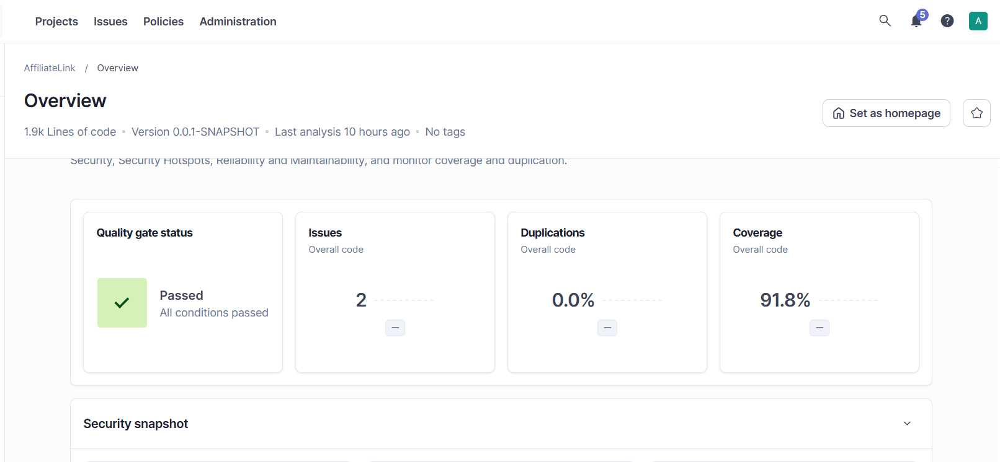

<p align="center">
  
  
  
  
  
  
  
</p>
<p align="center">
  
  
  
  
</p>

<h1 align="center">AffiliateLink — Affiliate Platform</h1>

<p align="center">
  <a href="./README.md">🇫🇷 Version française</a>
</p>

**AffiliateLink** affiliate platform, organized into **Spring Modulith** modules.

- The **profile** module manages the identity of every actor (publishers and advertisers) and their validation lifecycle, handled by an administrator.
- The **offer** module lets an active advertiser publish offers, then launch campaigns that set the period, budget and payout model for publishers (CPC, CPL or CPA).

The two modules are independent: they communicate only through their **public APIs** or through **events**, never by accessing the other's classes or tables.

The project is protected by **239 automated tests** (unit, repository, controller, module and full integration), **JaCoCo** coverage measurement and a **SonarQube** analysis: see [Tests](#tests) and [Code quality](#code-quality).

## Table of contents

- [Features](#features)
- [Business rules](#business-rules)
- [Tech stack](#tech-stack)
- [Architecture](#architecture)
- [Communication between modules](#communication-between-modules)
- [Data model](#data-model)
- [Quick start](#quick-start)
- [Configuration](#configuration)
- [API](#api)
- [Transactions and logging](#transactions-and-logging)
- [Troubleshooting](#troubleshooting)
- [Tests](#tests)
- [Code quality](#code-quality)
- [Design decisions](#design-decisions)
- [Known limitations](#known-limitations)

## Features

**Profile module**

- Create a **publisher** account (email, first name, last name, niche, bio, country)
- Create an **advertiser** account (email, company name, sector, website)
- Retrieve a profile by identifier, and list all publishers / advertisers
- Validate, suspend and reactivate an account as an administrator
- Publish the `ProfileSuspended` event when an account is suspended

**Offer module**

- Create and update an **offer** (title, description, landing page URL, niche, keywords)
- **Search** offers by optional, combinable criteria (niche, advertiser, tag, keyword in the title), paginated and sorted
- Retrieve an offer together with its campaigns
- Create a **campaign** (name, dates, budget, payout model and amount)
- Activate, pause, reactivate and end a campaign
- List campaigns, filterable by status
- Automatically pause the campaigns of a suspended advertiser, and notify publishers

## Business rules

### Profiles

| Rule | Description |
|---|---|
| Unique email | The same email cannot be used by both a publisher and an advertiser |
| Available niches | `BEAUTY`, `TECH`, `GAMING`, `TRAVEL`, `LIFESTYLE`, `FOOD`, `SPORT` |
| Default status | Every new account is created with status `PENDING` |
| Deletion | An account is never deleted, only suspended |

```
PENDING ──activate()──▶ ACTIVE ──suspend()──▶ SUSPENDED
                           ▲                      │
                           └──────reactivate()────┘
```

Any other transition throws an `InvalidStatusTransitionException` (HTTP 409). This logic lives in the `Profile` entity, not in the controllers.

### Offers

| Rule | Description |
|---|---|
| Active advertiser | Only an **existing and active** advertiser can create an offer (404 if it does not exist, 409 if it is not active) |
| Update | It re-checks that the advertiser is still active; an offer's `advertiserId` never changes |
| Tags | Stored in **lowercase**, **never duplicated**, **shared** between offers (an existing tag is reused) |
| Niche | Value of the `Niche` enum (same list as for profiles) |

### Campaigns

| Rule | Description |
|---|---|
| Initial status | A campaign is created as `DRAFT` |
| Dates and budget | `endDate` strictly after `startDate`; `budget` strictly positive |
| Past end date | The campaign cannot be activated |
| One active campaign per offer | Activating a campaign automatically pauses the one that was active on the same offer |
| Advertiser suspension | All of its active campaigns become `PAUSED` |

**Payout models**

| Model | Meaning | Expected amount |
|---|---|---|
| `CPC` | Pay per click | Fixed amount in euros, > 0 |
| `CPL` | Pay per sign-up (lead) | Fixed amount in euros, > 0 |
| `CPA_FIXED` | Pay per sale, fixed amount | Fixed amount in euros, > 0 |
| `CPA_PERCENT` | Pay per sale, percentage | Percentage > 0 and ≤ 100 |

**Status transitions** (owned by the `Campaign` entity: `activate()`, `pause()`, `end()`)

```
DRAFT ──▶ ACTIVE ◀──▶ PAUSED
             │           │
             └──▶ ENDED ◀┘        (ENDED: no way out)
```

| Current status | Allowed transitions |
|---|---|
| `DRAFT` | `ACTIVE` |
| `ACTIVE` | `PAUSED`, `ENDED` |
| `PAUSED` | `ACTIVE`, `ENDED` |
| `ENDED` | none |

Any other transition throws an `InvalidStatusTransitionException` (HTTP 409).

## Tech stack

| Component | Technology |
|---|---|
| Language | Java 17 |
| Framework | Spring Boot 4.1.1 (Spring Framework 7) |
| Modular architecture | Spring Modulith 2.1.1 (`core`, `jpa`, `test`) |
| Persistence | Spring Data JPA / Hibernate ORM 7 |
| Database | PostgreSQL 18 |
| Migrations | Flyway (`spring-boot-starter-flyway` + `flyway-database-postgresql`) |
| Entity ↔ DTO mapping | MapStruct 1.6.3 |
| Validation | Bean Validation (Jakarta) |
| Logging | SLF4J / Logback (console + rolling file) |
| Local environment | Docker Compose (started automatically by Spring Boot) |
| Build | Maven (wrapper included) |
| Tests | JUnit Jupiter, Mockito, AssertJ, Spring Boot Test, Spring Modulith Test |
| Integration tests | Testcontainers 2.0.5 (PostgreSQL 18 in Docker), Awaitility |
| Coverage | JaCoCo 0.8.13 (threshold: 60% of lines) |
| Quality | SonarQube Community Build (Docker, local) |

## Architecture

Organized **by feature** (package-by-feature). Every direct sub-package of the main package is a Spring Modulith **module**.

```
com.affiliateLink
├── common                               (open, shared module)
│   ├── GlobalExceptionHandler           (@RestControllerAdvice → ProblemDetail)
│   ├── Niche                            (enum shared by profile / offer)
│   ├── ResourceNotFoundException        → 404
│   ├── ConflictException                → 409
│   ├── DuplicateEmailException          → 409
│   └── InvalidStatusTransitionException → 409
│
├── profile
│   ├── ProfileApi                       ◀ public API
│   ├── AdvertiserInfo                   ◀ public record
│   ├── ProfileSuspended                 ◀ public event
│   └── internal                         (forbidden to other modules)
│       ├── controller   PublisherController, AdvertiserController, AdminProfileController
│       ├── dto          PublisherCreateRequest/Response, AdvertiserCreateRequest/Response, StatusUpdateRequest
│       ├── entity       Profile (abstract), Publisher, Advertiser, ProfileStatus
│       ├── repository   ProfileRepository, PublisherRepository, AdvertiserRepository
│       └── service      PublisherService, AdvertiserService, AdminProfileService, ProfileApiImpl
│
└── offer
    ├── OfferApi                         ◀ public API
    ├── CampaignInfo                     ◀ public record
    └── internal                         (forbidden to other modules)
        ├── controller   OfferController, CampaignController
        ├── dto          OfferCreateRequest, OfferUpdateRequest, OfferResponse, OfferSummaryResponse,
        │                CampaignCreateRequest, CampaignResponse, CampaignStatusUpdateRequest, PageResponse
        ├── entity       Offer, Campaign, Tag, PayoutModel, CampaignStatus
        ├── mapper       OfferMapper, CampaignMapper (MapStruct)
        ├── repository   OfferRepository, OfferSpecifications, CampaignRepository, TagRepository
        ├── service      OfferService / OfferServiceImpl, CampaignService / CampaignServiceImpl,
        │                OfferApiImpl, NotificationSender / LogNotificationSender
        └── listener     ProfileSuspendedListener, PublisherNotificationListener
```

**Golden rule**: only the classes at the **root** of a module are visible to other modules. Everything inside `internal` is private. This rule is enforced automatically by `ModularityTest` (`ApplicationModules.of(...).verify()`): the build fails if a module reaches into another module's `internal` package, or if there is a circular dependency.

Each layer has a single responsibility:

- **Controller**: exposes the REST API, delegates everything to the service
- **Service**: orchestrates business logic, exposes an **interface** and an implementation (`...Impl`)
- **Entity**: owns the invariant business rules (default status, transitions, amount bounds)
- **Mapper**: entity ↔ DTO conversions generated at compile time by MapStruct
- **DTO**: the only objects exposed by the API (`record`s) — JPA entities are never serialized directly

## Communication between modules

Two mechanisms, and only these:

| Mechanism | When | Example |
|---|---|---|
| **Direct call** through the public API | An immediate answer is needed | `offer` calls `ProfileApi.isActive(id)` |
| Domain **event** | Announce something without knowing who listens | `profile` publishes `ProfileSuspended` |

```
┌──────────── profile module ────────────┐        ┌───────────── offer module ─────────────┐
│                                        │        │                                        │
│  ProfileApi ◀──── synchronous call ────┼────────┼── OfferService / CampaignService       │
│   • getAdvertiser(id)                  │        │    (does the advertiser exist? active?)│
│   • isActive(id)                       │        │                                        │
│   • getActivePublisherEmails()         │        │                                        │
│                                        │        │                                        │
│  AdminProfileService                   │        │  ProfileSuspendedListener              │
│   suspend ─▶ ProfileSuspended ─────────┼─ event ┼─▶ sets ACTIVE campaigns to PAUSED      │
│                    │                   │        │                                        │
│                    └───────────────────┼─ event ┼─▶ PublisherNotificationListener        │
│                                        │        │    notifies active publishers          │
└────────────────────────────────────────┘        │                                        │
                                                  │  OfferApi ◀── future affiliate module  │
                                                  │   • getCampaign(id)                    │
                                                  └────────────────────────────────────────┘
```

### Public APIs

| API | Method | Returns |
|---|---|---|
| `ProfileApi` | `getAdvertiser(Long id)` | `Optional<AdvertiserInfo>` — never the `Advertiser` entity |
| `ProfileApi` | `isActive(Long id)` | `boolean` — `true` only if the advertiser exists and is `ACTIVE` |
| `ProfileApi` | `getActivePublisherEmails()` | `List<String>` |
| `OfferApi` | `getCampaign(Long campaignId)` | `Optional<CampaignInfo>` — meant for the future `affiliate` module |

`CampaignInfo` exposes `payoutModel` and `status` as `String` so it does not depend on the module's internal enums.

### Events

`ProfileSuspended(Long profileId)` is published by `AdminProfileService` when an account becomes `SUSPENDED` (and only then: activation publishes nothing).

Two listeners, in the `offer` module, annotated with `@ApplicationModuleListener`:

1. **`ProfileSuspendedListener`**: sets every `ACTIVE` campaign of the suspended advertiser's offers to `PAUSED`.
2. **`PublisherNotificationListener`**: asks active publishers to stop sharing the links, through the `NotificationSender` interface (currently implemented by `LogNotificationSender`).

`@ApplicationModuleListener` guarantees that the listener runs **after the commit** of the `profile` module's transaction, in **its own transaction**, **asynchronously** (`@EnableAsync`). The two listeners are **deliberately separate**: a failing notification must never prevent the campaigns from being paused.

### Event registry

Thanks to `spring-modulith-starter-jpa`, every event is stored in the `event_publication` table (migration `V4`), in the same transaction as the suspension. An event whose listener failed stays incomplete (`completion_date` is null): it is not lost.

## Data model

JPA inheritance with the **JOINED** strategy for profiles; a classic relational schema for offers. Each module owns **its own tables**, prefixed with its name.

```
profile_profiles (id, email UNIQUE, status, created_at)
        │
        ├── profile_publishers (id FK, first_name, last_name, niche, bio, country)
        └── profile_advertisers (id FK, company_name, sector, website)

offer_offers (id, advertiser_id, title, description, landing_url, niche, created_at)
        │ 1
        │                offer_offer_tags (offer_id, tag_id)        composite PK
        │ N ◀──────────────────────────────────────────────────▶ offer_tags (id, name UNIQUE)
        ▼
offer_campaigns (id, offer_id FK, name, start_date, end_date, budget,
                 payout_model, payout_value, status)
```

| Migration | Content |
|---|---|
| `V1` – `V3` | `profile_profiles`, `profile_publishers`, `profile_advertisers` |
| `V4` | `event_publication` (Modulith event registry) |
| `V5` | `offer_offers` |
| `V6` | `offer_campaigns` |
| `V7` | `offer_tags` |
| `V8` | `offer_offer_tags` (join table) |
| `V9` | Drops the unique constraint on the publishers' first name |

Key points:

- **`advertiser_id` is a plain `BIGINT`, with no foreign key** to `profile_advertisers`: the `offer` module never touches the `profile` tables. The advertiser's existence and state are checked through `ProfileApi`.
- Amounts are `NUMERIC(12,2)` (`BigDecimal`), dates are `DATE` (`LocalDate`), enums are stored as text.
- Database `CHECK` constraints (budget > 0, `end_date > start_date`, percentage ≤ 100, enum values) complement the application-level validation.
- **Partial unique index** `uq_offer_one_active_campaign ON offer_campaigns (offer_id) WHERE status = 'ACTIVE'`: the database guarantees an offer never has two active campaigns, even under concurrent access.
- JPA relationships: `Offer` 1—N `Campaign` (bidirectional, `Campaign` is the owning side); `Offer` N—N `Tag` (`Offer` is the owning side).

Tables are created and versioned through Flyway (`src/main/resources/db/migration`), with Hibernate in `ddl-auto: validate` mode — no schema change is ever made at runtime. A migration that has already been applied must never be edited: any fix goes into a new version.

## Quick start

### Prerequisites

- JDK 17+
- Docker Desktop (running)

### Run the application

```bash
./mvnw spring-boot:run
```

Spring Boot automatically detects `docker-compose.yml` and starts PostgreSQL before launching the application (the container keeps running after the application stops: `lifecycle-management: start-only`). Flyway applies the migrations on startup (`V1` to `V9`).

The API is available at `http://localhost:8080`.

### Inspect the database

```bash
docker exec -it affiliatelink-postgres-1 psql -U postgres -d affiliatelink
```

```sql
\dt
SELECT event_type, completion_date FROM event_publication;
```

## Configuration

### `docker-compose.yml`

```yaml
services:
  postgres:
    image: postgres:18
    environment:
      POSTGRES_DB: affiliatelink
      POSTGRES_USER: postgres
      POSTGRES_PASSWORD: admin
    ports:
      - "5433:5432"
    volumes:
      - affiliatelink-data:/var/lib/postgresql

volumes:
  affiliatelink-data:
```

### `application.yml`

```yaml
spring:
  docker:
    compose:
      enabled: true
      lifecycle-management: start-only    # PostgreSQL keeps running after the application stops
  jpa:
    hibernate:
      ddl-auto: validate
    properties:
      hibernate:
        default_batch_fetch_size: 20      # avoids the N+1 problem on tags
  flyway:
    enabled: true
    locations: classpath:db/migration
  data:
    web:
      pageable:
        default-page-size: 20
        max-page-size: 100                # prevents ?size=100000
  modulith:
    events:
      jdbc:
        schema-initialization:
          enabled: false                  # the event_publication table is created by Flyway (V4)
```

During tests, the `application.yml` database is **never** used: Testcontainers provides a throwaway PostgreSQL 18, and Spring Boot ignores `docker-compose.yml` in tests.

### `docker-compose.sonar.yml`

SonarQube Community, for local quality analysis (see [SonarQube analysis](#sonarqube-analysis-local)). It is deliberately **separate** from `docker-compose.yml`: otherwise Spring Boot would start SonarQube (about 2 GB of RAM) every time the application starts.

```yaml
name: affiliatelink-sonar

services:
  sonarqube:
    image: sonarqube:community
    container_name: affiliatelink-sonarqube
    ports:
      - "9000:9000"
    environment:
      SONAR_ES_BOOTSTRAP_CHECKS_DISABLE: "true"
    volumes:
      - sonarqube_data:/opt/sonarqube/data
      - sonarqube_extensions:/opt/sonarqube/extensions
      - sonarqube_logs:/opt/sonarqube/logs

volumes:
  sonarqube_data:
  sonarqube_extensions:
  sonarqube_logs:
```

### Logging — `logback-spring.xml`

- **Console** and **file** output (`logs/affiliatelink.log`)
- Size- and time-based rotation: 10 MB per file, compressed archives (`.gz`) in `logs/archived/`, 30 days of history, 1 GB cap
- `DEBUG` level for `com.affiliateLink` outside the `prod` profile, `INFO` elsewhere
- The `logs/` folder is ignored by Git

## API

### Offer module

| Method | Endpoint | Description | Responses |
|---|---|---|---|
| `POST` | `/api/offres` | Create an offer | `201` / `400` / `404` / `409` |
| `GET` | `/api/offres` | Search offers (paginated, sorted) | `200` / `400` |
| `GET` | `/api/offres/{id}` | Get an offer with its campaigns | `200` / `404` |
| `PUT` | `/api/offres/{id}` | Update an offer | `200` / `400` / `404` / `409` |
| `POST` | `/api/offres/{id}/campaigns` | Create a campaign (as `DRAFT`) | `201` / `400` / `404` / `409` |
| `GET` | `/api/campaigns?status=` | List campaigns (optional filter) | `200` / `400` |
| `PATCH` | `/api/campaigns/{id}/status` | Change a campaign's status | `204` / `400` / `404` / `409` |

### Profile module

| Method | Endpoint | Responses |
|---|---|---|
| `POST` | `/api/publishers` | `201` / `400` / `409` |
| `GET` | `/api/publishers` | `200` |
| `GET` | `/api/publishers/{id}` | `200` / `404` |
| `POST` | `/api/advertisers` | `201` / `400` / `409` |
| `GET` | `/api/advertisers` | `200` |
| `GET` | `/api/advertisers/{id}` | `200` / `404` |
| `PATCH` | `/api/admin/profiles/{id}/status` | `204` / `400` / `404` / `409` |

### Example — create an offer

```http
POST /api/offres
Content-Type: application/json

{
  "advertiserId": 1,
  "title": "Pro VPN",
  "description": "Fast and secure VPN",
  "landingUrl": "https://vpn.example.com",
  "niche": "TECH",
  "tags": ["VPN", "Security", " vpn "]
}
```

`201 Created` response — tags are normalized and de-duplicated:

```json
{
  "id": 1,
  "advertiserId": 1,
  "title": "Pro VPN",
  "description": "Fast and secure VPN",
  "landingUrl": "https://vpn.example.com",
  "niche": "TECH",
  "createdAt": "2026-11-10T10:15:00Z",
  "tags": ["vpn", "security"],
  "campaigns": []
}
```

### Example — create, then activate a campaign

```http
POST /api/offres/1/campaigns
Content-Type: application/json

{
  "name": "Winter Sale",
  "startDate": "2026-11-10",
  "endDate": "2027-01-31",
  "budget": 1000.00,
  "payoutModel": "CPC",
  "payoutValue": 0.50
}
```

The campaign is created with status `DRAFT`. To activate it:

```http
PATCH /api/campaigns/1/status
Content-Type: application/json

{ "status": "ACTIVE" }
```

If another campaign was already `ACTIVE` on the same offer, it automatically becomes `PAUSED`.

### Offer search

`GET /api/offres?niche=&advertiserId=&tag=&keyword=&page=&size=&sort=`

| Parameter | Description |
|---|---|
| `niche` | Value of the `Niche` enum |
| `advertiserId` | Offers of one advertiser |
| `tag` | Offers carrying this tag (case-insensitive) |
| `keyword` | Keyword contained in the title (case-insensitive) |
| `page` | Page number, **starting at 0** |
| `size` | Page size |
| `sort` | `field,asc` or `field,desc` |

- Every criterion is **optional** and they can be **combined**; with no criterion, all offers are returned.
- Sortable fields: `id`, `title`, `niche`, `createdAt`, `advertiserId`. Any other field → `400`.
- Without `sort`, the default order is `createdAt` descending (most recent first), for a stable order across pages.

```json
{
  "content": [ { "id": 3, "title": "Pro VPN", "niche": "TECH", "tags": ["vpn"] } ],
  "page": 0,
  "size": 10,
  "totalElements": 95,
  "totalPages": 10
}
```

The search is built dynamically with JPA **`Specification`**s (`OfferSpecifications`): each supplied criterion adds a condition, missing criteria are ignored.

### Error codes

All errors are centralized in a single `@RestControllerAdvice` (`GlobalExceptionHandler`, `common` module).

| Code | Cases |
|---|---|
| `400` | Bean Validation failure, unreadable JSON or unknown enum value, invalid parameter (`?niche=XYZ`), unsupported sort field |
| `404` | Unknown offer, campaign, profile or advertiser |
| `409` | Inactive advertiser, email already used, forbidden status transition, integrity conflict |
| `500` | Unexpected error: details in the logs only, generic message for the client |

Error format: **`ProblemDetail`** (RFC 9457), with `Content-Type: application/problem+json`.

```json
{
  "type": "about:blank",
  "title": "Conflict",
  "status": 409,
  "detail": "Advertiser is not active",
  "instance": "/api/offres"
}
```

For a validation error, `detail` lists the invalid fields (`email: must be a well-formed email address; ...`). For a `500` error, the client only receives `Internal server error`.

## Transactions and logging

### Transactions

- `@Transactional(readOnly = true)` on **every service** (optimized reads), `@Transactional` on every method that writes.
- **Atomic campaign activation**: pausing the previously active campaign (`saveAndFlush`, so the write precedes the activation and respects the unique index), then activating the new one. If a step fails (e.g. past end date), everything is rolled back: the previous campaign stays active.
- Suspending an account and **storing the event** in `event_publication` happen in the same transaction.
- `ProfileSuspended` listeners run **after the commit**, each in **its own transaction**.
- Business exceptions extend `RuntimeException`, which is what makes Spring roll the transaction back.

### Logging

One logger per class: `private static final Logger log = LoggerFactory.getLogger(MyClass.class);`

| Level | Usage |
|---|---|
| `INFO` | Successful business actions (creation, status change) |
| `WARN` | Expected abnormal situation (refused transition, inactive advertiser) |
| `ERROR` | Unexpected error (with stack trace) |
| `DEBUG` | Detail (search criteria) |

**No sensitive data** in the logs: no email or personal data (notifications only log the number of recipients).

## Troubleshooting

**`PostgreSQL Database directory appears to contain a database; Skipping initialization`**
An existing Docker volume still holds data from a previous attempt. Remove the volume (`docker volume rm affiliatelink_affiliatelink-data`) to start from a clean state.

**`Unsupported Database: PostgreSQL X.X`**
Check that the `flyway-database-postgresql` dependency is present in `pom.xml`, alongside `spring-boot-starter-flyway`.

**PostgreSQL 18 and the data volume**
Starting with the `postgres:18` image, mount the volume on `/var/lib/postgresql` (not `/var/lib/postgresql/data`) — the image manages the versioned subdirectory itself.

**`Migration checksum mismatch for migration version N`**
An already-applied migration was modified (typically: a file created empty while the application was running, then filled in). Never edit an applied migration: create a new version. In development, if the migration had been applied *empty*, delete its row from `flyway_schema_history` so Flyway replays it.

**`Unresolved compilation problem` / `TestMapper cannot be resolved`**
A MapStruct-generated `*MapperImpl` class is still in `target/classes` although the interface was deleted. Run `./mvnw clean compile` (and, in VS Code, `Java: Clean Java Language Server Workspace`).

**`Unresolved compilation problems` during `./mvnw verify`, although the code compiles**
This message comes from VS Code's compiler (Eclipse JDT), never from `javac`: VS Code recompiled into `target/` at the same time as Maven. Run the command again; if the error comes back, turn off `Java: Build Automatically` (or close VS Code) during the build.

**`logs/affiliatelink.log` is not created / `XML_PARSING` error at startup**
`logback-spring.xml` must start with `<?xml ...?>` on the **very first line**, with no blank line or BOM before it.

**`./mvnw test -Dtest=ModularityTest` fails (`depends on non-exposed type`)**
A module uses a class from another module's `internal` package. A listener must live in the module that **reacts** to the event (here `offer`) and only import the root of the other module.

**`Query validation failed for '...'` at startup**
Spring Data validates every `@Query` at startup: an invalid JPQL query prevents the whole context from loading, and makes every test that starts Spring fail. Check the `SELECT c FROM Campaign c WHERE ...` shape, the exact entity and field names, and named parameters written without a space (`:status`).

**Tests: `Connection to 127.0.0.1:5433 refused`**
A test that starts Spring uses the `application.yml` database instead of Testcontainers. Add `@Import(PostgresTestConfiguration.class)` to it, or make it extend `AbstractIntegrationTest`.

**Tests: `Could not find a valid Docker environment`**
Testcontainers needs Docker: start Docker Desktop before `./mvnw verify`.

**`'build.plugins.plugin.version' ... must be a valid version but is '${jacoco.version}'`**
The `jacoco.version` property is missing from the `pom.xml` `<properties>`.

**PowerShell: `-Dsonar : The term '-Dsonar' is not recognized`**
The command suggested by SonarQube is written for bash: the trailing `\` does not exist in PowerShell. Pass the token through the `SONAR_TOKEN` variable and run a single line (see [SonarQube analysis](#sonarqube-analysis-local)).

## Tests

Brief 4 adds a **safety net**: automated tests that check the business rules on every build, at every level of the application.

### Running the tests

```bash
./mvnw test       # unit tests (*Test): a few seconds, no Docker
```

```bash
./mvnw verify     # unit + integration (*IT) + JaCoCo report + coverage threshold
```

`./mvnw clean verify` passes on a machine that **only has Java 17 and Docker**:

- no Maven to install: the `mvnw` wrapper downloads it;
- no local PostgreSQL: **Testcontainers** starts a throwaway PostgreSQL 18 (`PostgresTestConfiguration`, `@ServiceConnection`);
- `docker-compose.yml` does not need to be running.

### Naming convention

| Suffix | Run by | Maven phase | Content |
|---|---|---|---|
| `*Test` | Surefire | `test` | Tests without Spring or a database |
| `*IT` | Failsafe | `integration-test` | Tests that start Spring and/or PostgreSQL |

Shared support classes (no tests of their own): `AbstractIntegrationTest` (base of the full integration tests), `OfferModuleSupportTest` (base of the offer module tests), `PostgresTestConfiguration` (PostgreSQL container) and `ProblemDetailMatchers` (assertions on error content).

### Test pyramid

| Level | Tools | Classes | Tests |
|---|---|---|---|
| Unit | JUnit, Mockito, AssertJ | 14 | 58 |
| Repository and migrations | `@DataJpaTest`, Testcontainers | 6 | 62 |
| Controller | `@WebMvcTest`, `@MockitoBean` | 5 | 60 |
| Mapper | `@SpringJUnitConfig` | 1 | 3 |
| Module | `@ApplicationModuleTest`, Testcontainers | 3 | 14 |
| Full integration | `@SpringBootTest`, MockMvc, Testcontainers | 4 | 42 |
| **Total** | | **33** | **239** |

### Details by level

**Unit (`*Test`)**: no Spring, no database, dependencies mocked with Mockito.

| Class | What it checks |
|---|---|
| `CampaignTransitionTest` | Every campaign status transition, allowed and forbidden (`@ParameterizedTest`) |
| `CampaignEndDateTest` | A campaign whose end date has passed cannot be activated |
| `CampaignCreateRequestTest` | Payout rules (amount > 0, percentage ≤ 100) and `endDate` after `startDate` |
| `TagTest` | Tag normalization (lowercase, no spaces) |
| `AdvertiserServiceImplTest` | Profile created as `PENDING`, email already used refused without any `save`, unknown profile |
| `CampaignServiceTest` | Campaign creation (active or inactive advertiser, unknown offer) and exclusive activation |
| `OfferServiceTest` | Offer update, unknown offer, inactive advertiser |
| `ProfileApiImplTest`, `OfferApiImplTest` | Public module APIs |
| `ProfileSuspendedListenerTest`, `PublisherNotificationListenerTest` | `ProfileSuspended` listeners |
| `LogNotificationSenderTest` | Sending (logging) notifications |
| `GlobalExceptionHandlerTest` | Translating exceptions into `ProblemDetail` |
| `ModularityTest` | `ApplicationModules.of(...).verify()`: no access to an `internal` package, no circular dependency |

**Repository and migrations (`*IT`)**: `@DataJpaTest` on a real PostgreSQL 18.

| Class | What it checks |
|---|---|
| `OfferSpecificationsIT` | Offer search: each criterion alone, a combination, no criterion |
| `OfferPaginationIT` | Offer pagination and sorting |
| `CampaignRepositoryIT` | Campaign queries |
| `TagRepositoryIT` | Tags are unique and shared between offers |
| `ProfileRepositoriesIT` | Profile queries |
| `MigrationsIT` | Flyway migrations: schema and database constraints |

**Controller (`*IT`)**: `@WebMvcTest`, one test per controller, services replaced with `@MockitoBean`.

`AdvertiserControllerIT`, `PublisherControllerIT`, `AdminProfileControllerIT`, `OfferControllerIT` and `CampaignControllerIT` check the `201`, `400`, `404` and `409` codes, with the `ProblemDetail` content for every error.

**Module (`*IT`)**: `@ApplicationModuleTest`, one module started on its own.

| Class | What it checks |
|---|---|
| `ProfileModuleIT` | Suspension publishes `ProfileSuspended`; activation publishes nothing |
| `OfferModuleIT` | Listening to `ProfileSuspended` in the offer module, with `ProfileApi` replaced by a mock |
| `OfferEventRegistryIT` | Event registry: a failing listener leaves the event incomplete |

**Full integration (`*IT`)**: `@SpringBootTest`, end-to-end journeys, no mocks.

| Class | Journey |
|---|---|
| `AdvertiserRegistrationIT` | An advertiser registers, then their profile is retrieved; registering twice with the same email (`409`, nothing is created) |
| `CampaignJourneyIT` | Create an offer and two campaigns, successive activations: the first one becomes `PAUSED` |
| `OfferSearchIT` | Paginated and sorted search, single and combined criteria |
| `AdvertiserSuspensionIT` | Suspending an advertiser: its active campaigns become `PAUSED`, the others do not change |

### Rules followed

- **Given / When / Then** in every test, and a method name that describes the expected behavior (e.g. `registeringTwiceWithTheSameEmailIsRefusedAndCreatesNothing`).
- **Independent tests**: the database is emptied before each full integration test (`TRUNCATE ... RESTART IDENTITY CASCADE` in `AbstractIntegrationTest`), and emails are generated (`UUID`) when uniqueness matters.
- **Asynchronous listeners**: tests wait for the effect with **Awaitility**, without `Thread.sleep`, and without `@Transactional` on the test (otherwise the listener, which runs after the commit, would never be called).

## Code quality

### Coverage — JaCoCo

`./mvnw verify` generates the report in `target/site/jacoco/index.html` (plus `jacoco.xml`, read by SonarQube). The JaCoCo plugin:

- instruments **both** test families (`prepare-agent` feeds Surefire and Failsafe);
- **fails the build** if fewer than **60% of lines** are covered (`check` rule, `LINE` counter);
- excludes the main class, configuration, DTOs and MapStruct-generated code (the project does not use Lombok).

| JaCoCo exclusion (`.class`) | SonarQube exclusion (`.java`) |
|---|---|
| `**/AffiliateLinkApplication.class` | `**/AffiliateLinkApplication.java` |
| `**/*Config*.class` | `**/*Config*.java` |
| `**/dto/**` | `**/dto/**` |
| `**/*MapperImpl.class` | `**/*MapperImpl.java` |

**Result: 93.2% of lines covered** (required threshold: 60%).

### SonarQube analysis (local)

1. Start SonarQube (with Docker Desktop running), then wait for `SonarQube is operational` in the container logs:

   ```bash
   docker compose -f docker-compose.sonar.yml up -d
   ```

2. Open `http://localhost:9000` (first login: `admin` / `admin`, then change the password).
3. Create a local project with the key **`affiliatelink`** (the one in `pom.xml`), then generate a **token**.
4. Run the analysis. The `sonar.*` parameters are already in `pom.xml`: only the token has to be provided.

   ```bash
   export SONAR_TOKEN=<your_token>
   ./mvnw clean verify sonar:sonar
   ```

   In PowerShell:

   ```powershell
   $env:SONAR_TOKEN="<your_token>"
   .\mvnw.cmd clean verify sonar:sonar
   ```

5. Stop SonarQube, without `-v` to keep the analyses:

   ```bash
   docker compose -f docker-compose.sonar.yml down
   ```

> The token is a secret: it must appear neither in `pom.xml` nor in any versioned file.

**Latest analysis result**

| Metric | Value |
|---|---|
| Quality Gate | ✅ **Passed** (all conditions met) |
| Issues (overall code) | 2 |
| Duplications | 0.0% |
| Coverage | 91.8% |



The coverage shown by SonarQube (91.8%) differs slightly from JaCoCo's (93.2%): SonarQube combines **line** coverage and **condition** coverage (both branches of an `if`), whereas the JaCoCo rule only counts lines.

## Design decisions

- **No foreign key between modules.** `offer_offers.advertiser_id` is a plain identifier: the modules stay independent, including at database level. Trade-off: integrity is guaranteed by the service (through `ProfileApi`), not by the database.
- **Public API = interface + record.** Other modules never see an entity or an internal enum (`AdvertiserInfo`, `CampaignInfo`): entities can evolve without breaking consumers.
- **Event to react, direct call to query.** `profile` does not know `offer`: it announces a fact (`ProfileSuspended`).
- **Two distinct listeners** for the same suspension: a notification outage does not block pausing the campaigns.
- **Database safeguard** for "one active campaign per offer" (partial unique index), on top of the application logic.
- **Service interfaces and `NotificationSender`**: open/closed principle. A real email sender can replace `LogNotificationSender` without touching the listener.
- **`Specification` rather than Querydsl**: provided by Spring Data JPA, no extra code generation.
- **Sort-field whitelist**: sorting on an unknown field returns `400` instead of a server error.
- **MapStruct** for every entity ↔ DTO conversion; fields that need the database (tags, campaigns) are filled in by the service.

## Known limitations

- **No authentication**: nothing checks that an advertiser edits *their own* offer. Security is planned for the next sprint.
- **Publisher notification**: until the `affiliate` module exists, nothing links a publisher to a campaign. The notification is therefore aimed at **all active publishers**, and it is limited to a log message.
- Reactivating an advertiser does **not** automatically reactivate its campaigns: they stay `PAUSED` and the advertiser reactivates them explicitly.
- `OfferApi` is deliberately minimal (a single method): it anticipates the future `affiliate` module.
- **Reactivating a campaign during a suspension**: `CampaignServiceImpl.changeStatus()` does not check that the advertiser is active. A suspended advertiser can therefore set a `PAUSED` campaign back to `ACTIVE` (`PATCH /api/campaigns/{id}/status`).

---

<p align="center"><sub>Sprint 3 — Briefs 3 & 4 · AffiliateLink · OUTERGA MOUSTAFA</sub></p>